# Set up next

Some choices in the interview need work that the interview cannot do. After **Create**, the survey builder shows the **Set up next** list above the questions. Each card names one step. This page tells you exactly how to do each step.

<Note>
Interview Mode is in development. It is not available in installed AutoSurvey orgs yet. This page tells you what the interview does when it is available.
</Note>

## How to read a card

Each card shows:

- A title, and what to do and why.
- **Who** does it: **You, or an admin**, **An admin** or **AutoSurvey**.
- **Steps**: click it to see the numbered steps. They are the same steps as on this page.
- **How to do it**: a link to the section of this page for that card.
- A button that opens the page where you do the step. Some pages open with the survey. Other pages tell you which survey to pick.
- A state: **Needs setup**, **Done**, **Feature is off**, **Set up for you**, **Ready in the org**, **After release** or **Marked done**. AutoSurvey reads the real setting to find **Done**.
- **Dismiss** and **Don't suggest this again**. **Don't suggest this again** applies to this survey only. Some cards also have **Mark as done**.

When a card shows **Feature is off**, its button is **Open AutoSurvey Setup**. An admin turns the feature on under **Optional Capabilities**. Then the card opens the page of its step.

The sections below are in the order of the cards.

## Low-score alert

**Who:** AutoSurvey. You, or an admin, do the steps.

**Why:** A low score makes a follow-up task for a person, so nobody misses an unhappy answer. AutoSurvey marks the response. A Flow makes the task.

**Steps:**

1. Click Open the survey settings.
2. Click the Scoring & alerts card.
3. Under Negative responses, click Mark negative responses.
4. Tick The main score is in its lowest band, then click Save.
5. Under Templates you can start from, click Set up next to the Negative Case Feedback Follow-Up template.
6. In Flow Builder, click the arrow next to Save As New Version, then click Save As New Flow. Then click Activate on the copy.

- The Flow makes a Task only for a response that is linked to a Case. For a response with no Case, use the recovery Flow in [Follow-up email after a complaint](#follow-up-email-after-a-complaint).
- The Settings tab has no control for who gets the Task. The interview sets it. The default is the survey owner.

<Frame>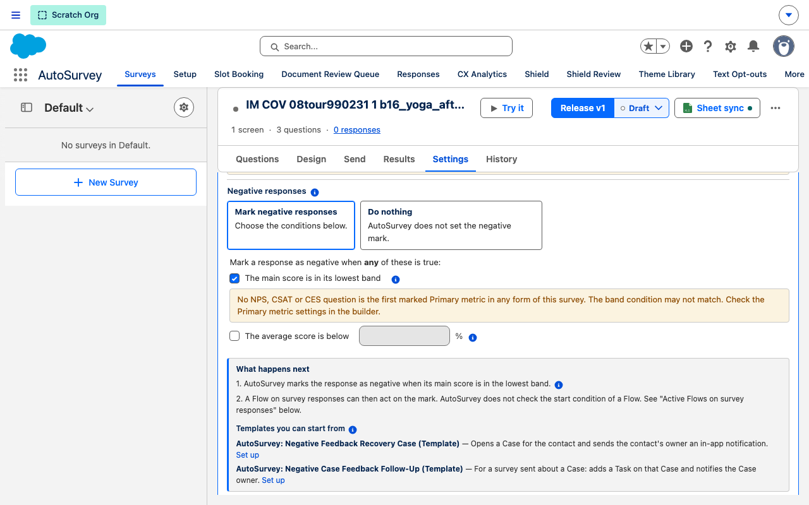</Frame>

**More:** [Low-score alerts](/alerts/low-score)

## Ask happy people for a review

**Who:** An admin

**Why:** A high score can start a review request. Then your best answers become public reviews.

**Steps:**

1. Click Open the survey settings.
2. Click the Scoring & alerts card.
3. Under Positive responses, click Mark positive responses, tick The main score is in its top band, then click Save.
4. Under Templates you can start from, click Set up next to the Promoter Review Request template.
5. In Flow Builder, click the arrow next to Save As New Version, then click Save As New Flow.
6. In the text template ttEmailBody, replace the placeholder link with your review page, then click Save and Activate.

- The Flow starts on a survey response (Survey Submission) that has the positive mark and a Contact. It sends one email, logs a Task on the Contact and notifies the Contact owner.
- The Flow ships inactive, as a template. Do not activate it before you replace the placeholder link.

<Frame>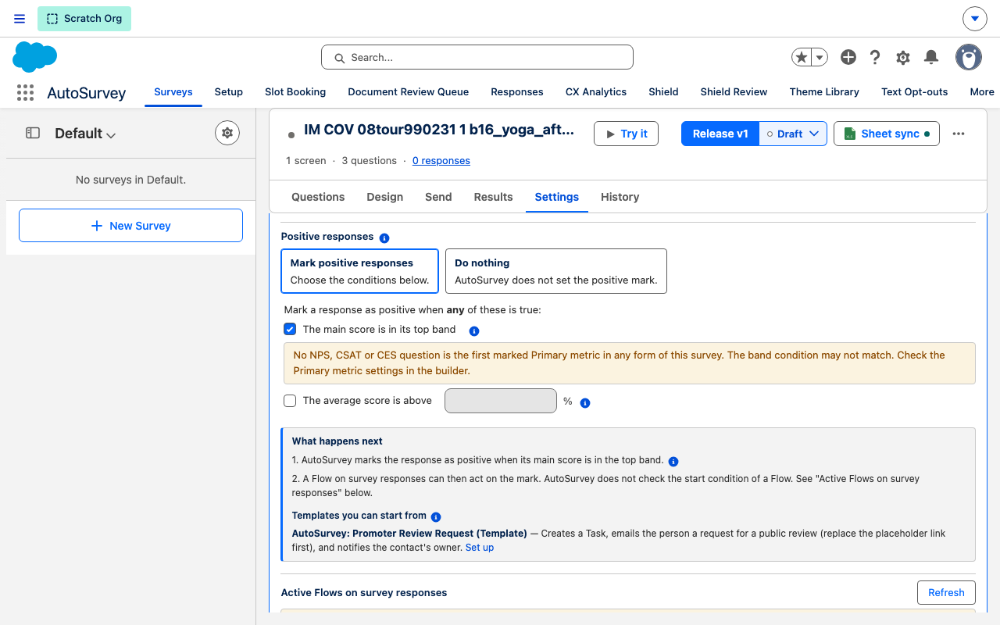</Frame>

**More:** [Scoring and Alerts](/admin/scoring-and-alerts)

## Send when a case closes

**Who:** An admin

**Why:** A Flow can send this survey when a case, a ticket or an order closes. Then each customer gets it at the right time.

**Steps:**

1. Click Open Flows, then click New Flow and choose Record-Triggered Flow.
2. Set Object to Case, trigger A record is updated, condition Status Equals Closed.
3. Choose Only when a record is updated to meet the condition requirements, and Actions and Related Records.
4. Add an Action element and select Send AutoSurvey Invitation.
5. Set Form Code, Recipient Type Contact, Recipient Record Id {!$Record.ContactId}, Related Record Id {!$Record.Id}.
6. Set Related Object API Name Case and Send Channel Email, then click Save and Activate.

- AutoSurvey has no ready Flow for this. You make a new record-triggered Flow. The Flow calls the AutoSurvey action **Send AutoSurvey Invitation** (category **AutoSurvey**).
- Release the survey before the Flow runs. The action sends only a released form.
- **Form Code** is the code of the form to send. To find it, open the survey **Send** tab and click **Copy link**. The code is the text after `formCode=` in the link. The response viewer also shows it as **Form Code**.
- Leave **Recipient Email** empty. The action reads the email from the Contact.
- For a ticket or an order, use that object and its contact field in place of Case and ContactId.
- When the Flow is active, click **Mark as done** on the card. AutoSurvey cannot check this step.

<Frame>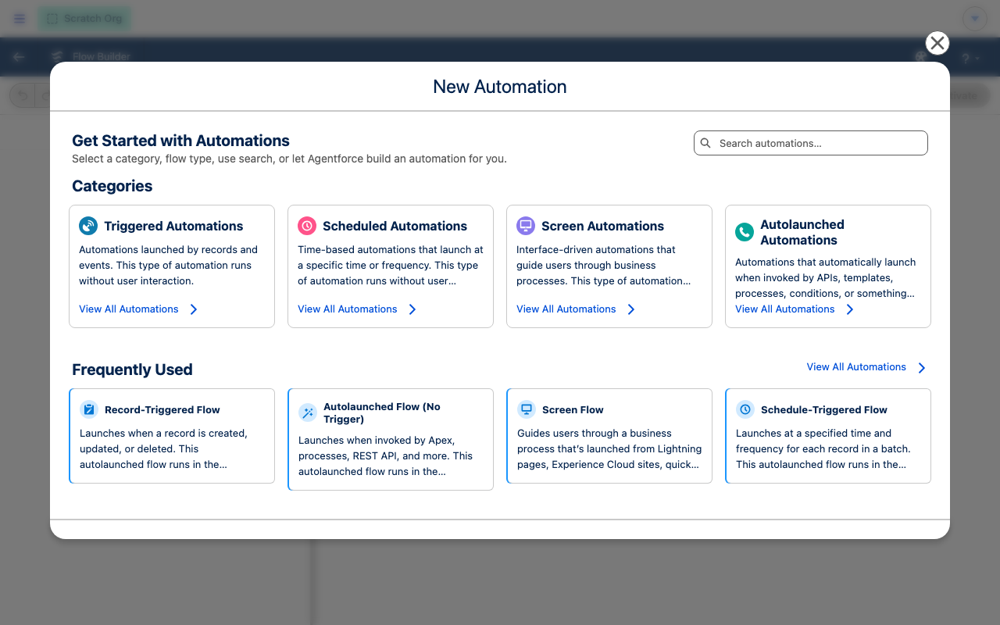</Frame>

**More:** [Send a survey](/workflows/send-a-survey)

## Follow-up email after a complaint

**Who:** An admin

**Why:** A low score or a complaint can open a recovery case. Then the person hears from you fast.

**Steps:**

1. Click Open the example flow. If the card shows Open Flows, open AutoSurvey: Negative Feedback Recovery Case (Template).
2. In Flow Builder, click the arrow next to Save As New Version, then click Save As New Flow.
3. To also email the person, add a Send Email action after Create Recovery Case.
4. Click Save, then click Activate on the copy.
5. On the survey Settings tab, open Scoring & alerts and turn on Mark negative responses.
6. Click Mark as done on the card.

- The template is **AutoSurvey: Negative Feedback Recovery Case (Template)**. It ships inactive. It starts on a survey response (Survey Submission) that has the negative mark, has a Contact and is not about a Case.
- The template opens one Case for the Contact and sends the Contact owner an in-app notification. It does **not** send an email. Add a Send Email action to your copy if you want one.
- The card can show **Open Flows** in place of **Open the example flow**. This happens when you cannot read the list of Flows.

<Frame>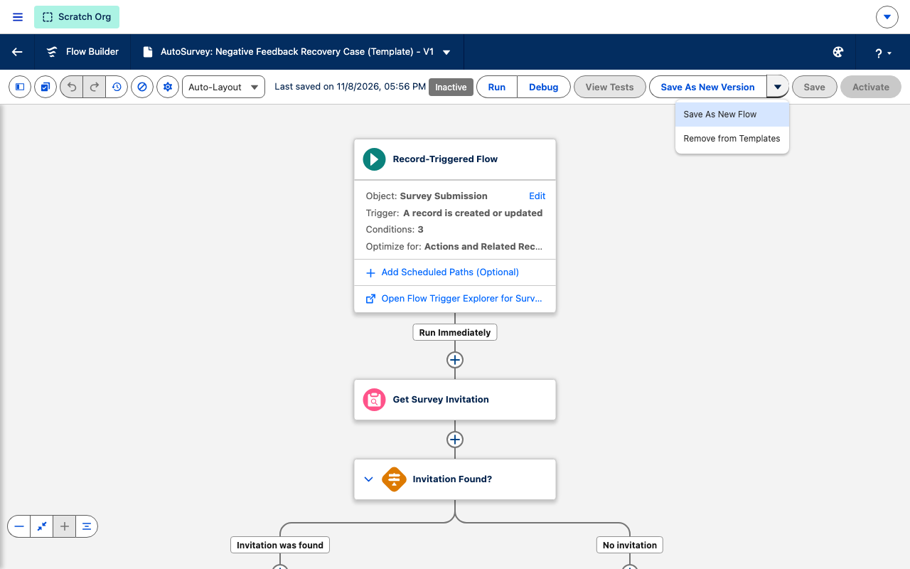</Frame>

**More:** [Scoring and Alerts](/admin/scoring-and-alerts)

## Text message invitations

**Who:** An admin

**Why:** You chose to send invitations by text message. An admin must set up text messaging first.

**Steps:**

1. Click Open Text Messaging setup.
2. Under Sender, in How texts are sent, choose Twilio or My own Flow.
3. Under Sending user, choose the user, click Save sending user, then click Assign permission set.
4. For Twilio, type the Account SID and Auth Token, click Save and verify, then fill Send from.
5. For My own Flow, copy AutoSurvey: Text Sender (Template), activate it, type its Flow API name, click Save Flow.
6. As the sending user, click Activate sending, then click Send test text.

- The sending user needs the **AutoSurvey Text Sending** permission set. Only that user can click **Activate sending**.
- With **My own Flow**, AutoSurvey builds the link and the message. Your SMS tool sends it. Start from **AutoSurvey: Text an Invitation (Template)** and **AutoSurvey: Text Sender (Template)**.

<Frame>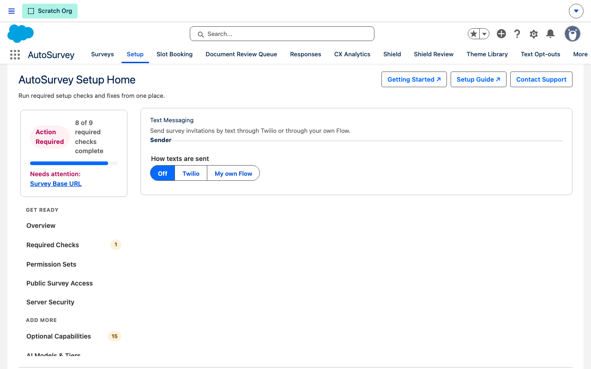</Frame>

**More:** [Text messages](/text-messages)

## Ask for a document

**Who:** An admin

**Why:** A document request is a checklist of files and forms. It is separate from the survey. For one file only, add a File Upload question in Design.

**Steps:**

1. Click Open the Template Builder.
2. Click New template, choose Start blank, type the Name of the template, then click Make a blank Draft.
3. Type the Message to the client and the Due after (days).
4. Under Request items, click File upload or another item kind, then fill in the item.
5. Click Save, click Review readiness, then click Activate.
6. Tell staff to send the request from a Contact, Lead or Case with Create request.

- Only an **Active** template can be sent. **Review readiness** shows what you must fix before **Activate** is available.
- Staff need the `Document_Request_User` permission set.

<Frame>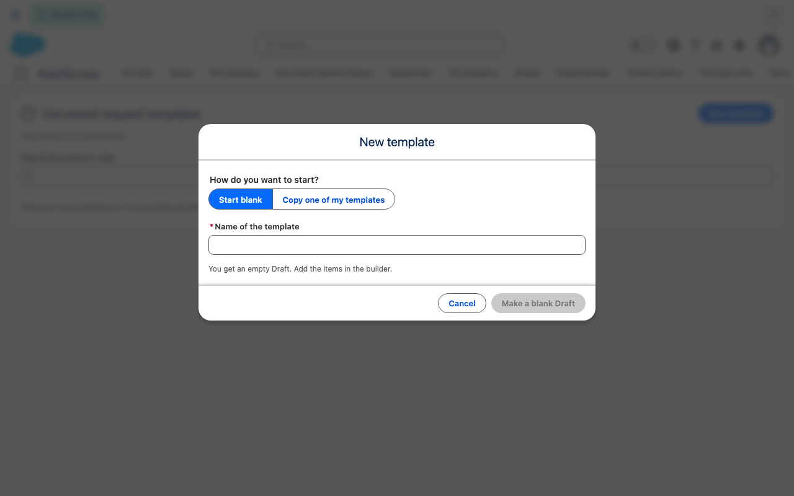</Frame>

**More:** [Document Request Admin Setup](/document-request/admin-setup)

## Leads from answers

**Who:** You, or an admin

**Why:** You chose to make a lead from each answer. Choose who gets the leads.

**Steps:**

1. Click Open the survey settings.
2. Click the Data card and turn on Create a record from each response.
3. Set Object to Lead, then use Add fixed value for fields that every Lead needs, for example Company.
4. Choose the Owner of created records.
5. Tick Use the org's assignment rules if your org has an active Lead rule, then click Save.
6. Or, on the card, click Keep: leads go to me or Use the org's assignment rules.

- The **Create a record from each response** section shows only when the **Intake to Record** switch is on in AutoSurvey Setup.
- The card button **Use the org's assignment rules** shows only when the org has an active Lead assignment rule.
- A change applies at the next release.

<Frame>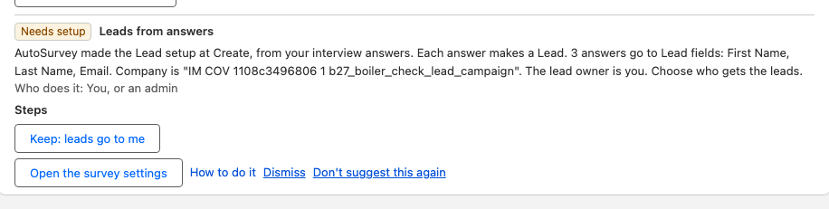</Frame>

**More:** [Lead capture](/lead-capture)

## Share the results with care

**Who:** You, or an admin

**Why:** The survey does not ask for a name or email. A personal invitation still links each answer to the person. Share only summary results, so nobody can find who gave an answer.

**Steps:**

1. Click Open the results.
2. Share totals and charts only. Do not share single answers or the response list.
3. In AutoSurvey Setup, on Recommended Checks, find Share the Survey Reports folder and click Share with all internal users.
4. Assign the AutoSurvey Raw Response Access permission set only to people who may see single answers.
5. Click Got it on the card.

- This card is advice. It has no setting to check. **Got it** closes it.

<Frame>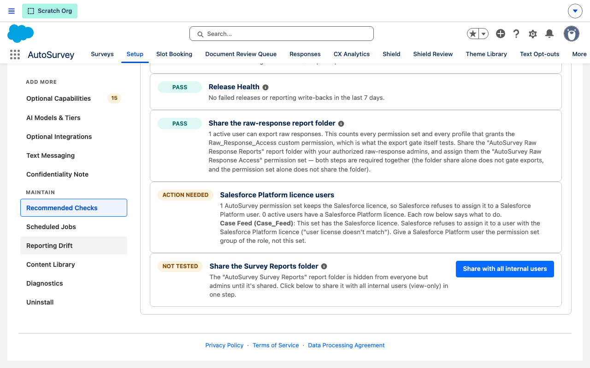</Frame>

**More:** [Objects, permissions and layouts](/admin/objects-permissions-layouts)

## Reward for answers

**Who:** An admin

**Why:** You chose to offer a reward. Shield Rewards pays people for a complete answer after an approval.

**Steps:**

1. Click Open Shield Rewards. This tab lists the rewards that wait for approval.
2. Open the Shield Settings tab.
3. Click Protect a form or suite, find this survey, tick On, then click Save binding.
4. Under Rewards, add a budget with New budget if the list is empty.
5. In Reward rules, click Edit next to this survey, then set Reward amount (USD), Tremendous campaign id, Budget and Approval.
6. Click Activate offer v1.

- The card opens the **Shield Rewards** tab. That tab is the approval queue. You set up the reward on the **Shield Settings** tab.
- The card shows **Done** when the survey has an enabled Shield binding with the reward on.
- Shield Rewards needs the **Fraud & Quality Shield** switch on in AutoSurvey Setup.

**More:** [Rewards](/rewards)

## Add the languages

**Who:** You, or an admin

**Why:** You chose more languages. Add each language to this survey, then check the translations.

**Steps:**

1. Click Open the survey settings.
2. Find the Languages card.
3. In Select a language…, pick a language, then click Add language.
4. Wait while AutoSurvey translates the survey with AI.
5. Review each translation in the survey preview before you rely on it.
6. Repeat for each language that you need.

- The **Languages** card shows only when the **Multi-language** switch is on in AutoSurvey Setup. While it is off, the card button opens AutoSurvey Setup.
- A person must review an AI translation before you rely on it.

**More:** [Languages](/languages)

## Set the reminders

**Who:** You, or an admin

**Why:** You chose reminders. Set the reminder schedule, so people who did not answer get a reminder.

**Steps:**

1. Click Open the Send tab.
2. Send the survey. The Follow-up reminders line shows after the first send.
3. On the Follow-up reminders line, click Turn on.
4. Click Edit schedule… to open Reminder settings.
5. Set First reminder after (days), Repeat every (days) and Max reminders per person, and tick Email.
6. Click Save.

- The **Follow-up reminders** line is at the bottom of the Send tab. It shows only after the survey has a send, or when reminders are on.
- While **Dry-run mode** shows, AutoSurvey logs the reminders and sends no email. An admin turns on **Send reminder email for real** in the AutoSurvey settings.

**More:** [Reminders](/reminders)

## Set the close date

**Who:** You, or an admin

**Why:** You chose to close the survey on a date. Set the close date, so late answers stop.

**Steps:**

1. Release the survey first. A draft has no close date.
2. Click Open the Results tab.
3. Click Stop accepting responses….
4. Choose Schedule close.
5. Set the date and time in Close at.
6. Click Schedule close.

- **Stop accepting responses…** shows only on a released survey that is open. It is also in the ⋯ menu.
- The Send tab shows the close date, but you set it on the Results tab.

**More:** [Close date](/close-date)

## Connect a Google Sheet

**Who:** You, or an admin

**Why:** You chose to copy the answers to a Google Sheet. Connect the sheet for this survey.

**Steps:**

1. Click Open the survey settings.
2. Click the card The questions sheet.
3. Click Connect a sheet…. If the survey has a sheet, the button is Change sheet….
4. Pick the Google Sheet, then confirm.

- AutoSurvey has no feature that copies each answer to a Google Sheet yet, so this card does not show today. **The questions sheet** card connects the sheet that holds the questions.

<Frame>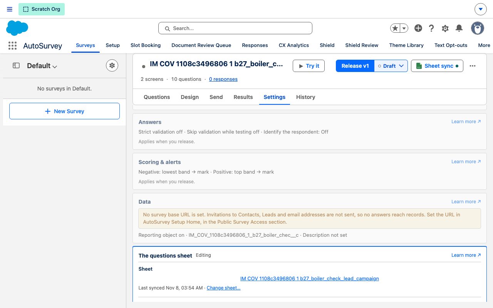</Frame>

**More:** [Google Sheets sync](/google-sheets-sync)

## Choose the questions for each round

**Who:** You, or an admin

**Why:** You chose rounds with different questions. Choose the questions for each round.

**Steps:**

1. Click Open the questions.
2. Click the ⋯ (More) menu at the top of the survey.
3. Click Manage audiences & waves….
4. Under View, click Questions & forms.
5. Tick the questions for each round, then click Apply changes.
6. Click Mark as done on the card.

- The Apply button names the number of changes, for example **Apply 3 changes**. Nothing is saved until you click it.
- The survey must have a connected Google Sheet.
- Click **Mark as done** on the card when you finish. AutoSurvey cannot check this step.

<Frame>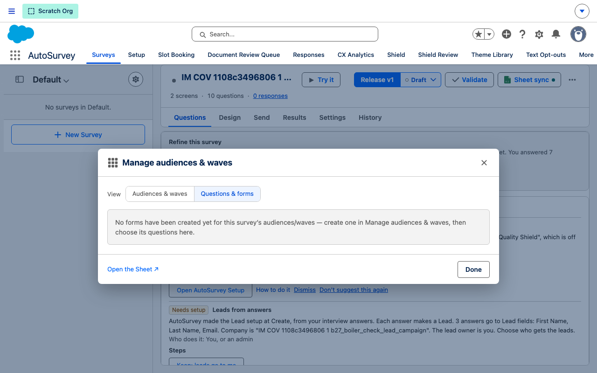</Frame>

**More:** [Rounds](/rounds)

## Add the logo

**Who:** You, or an admin

**Why:** You chose to add a logo later. Add it on the Design page, so people see your brand.

**Steps:**

1. Click Open Design.
2. Open the Header & text section.
3. At Logo, click Choose a file and pick your logo, or type its web address.
4. Check the logo in the preview.
5. Click Save draft, then release the survey to make the logo live.

- This card has no done check. Click **Dismiss** when you finish.

<Frame>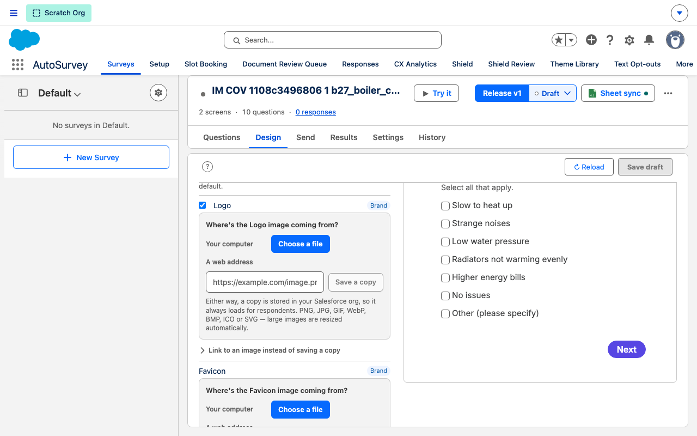</Frame>

**More:** [Design, logo and colors](/design)

## Type the finish page address

**Who:** You, or an admin

**Why:** You chose to send people to a page when they finish. Type the address of that page.

**Steps:**

1. Click Open Design.
2. Above the preview, click the screen with the flag ⚑. This is the ending.
3. In Ending content, type the Redirect URL. It starts with https://.
4. Optional: type the Redirect link label.
5. Click Save ending.
6. Release the survey to make the change live.

- The address has 255 characters at most.

**More:** [Thank-you page and redirect](/thank-you-page)

## Add the survey to a campaign

**Who:** You, or an admin

**Why:** You chose to link this survey to a campaign. AutoSurvey adds the survey under Campaign Surveys at once, also before you release.

**Steps:**

1. Find the Campaign box on the card. If no campaign is free to link, the card shows only New campaign.
2. Pick a campaign, then click Link.
3. Or type a name in New campaign, then click New campaign.
4. Release the survey. Sends to the campaign start after you release.

- You do this step on the card itself. The card has no button that opens another page.
- When a campaign member answers, AutoSurvey sets the member status to **Responded**.

<Frame>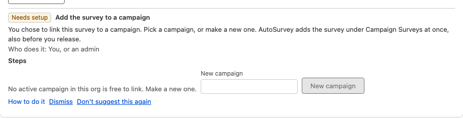</Frame>

**More:** [Campaign link](/campaign-link)

## Map the answers to records

**Who:** You, or an admin

**Why:** You chose to save answers on Salesforce records. Map each answer to a field.

**Steps:**

1. Click Open the survey settings.
2. Click the Data card.
3. Under Answers written to records, click Add mapping.
4. Choose the Source, the Question, Written to and the Field.
5. Click Save. The map applies at the next release.

- The **Answers written to records** editor hides while **Create a record from each response** is on with an object. Then you map the answers in that section.
- The map writes to the record that the response is about. It does not make a new record.

<Frame>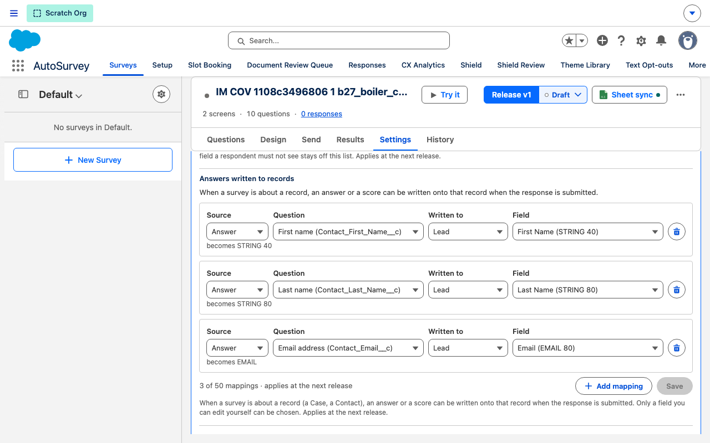</Frame>

**More:** [Answers to records](/records)

## Related

- [Interview Mode](/interview-mode) — how the interview works.
- [Scoring and Alerts](/admin/scoring-and-alerts) — the marks and the follow-up Flows.
- [AutoSurvey Setup](/admin/setup) — the feature switches.
